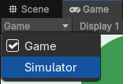
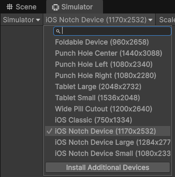

# Running

If you have a Game tab, change it to Simulator.

Then choose a standard phone size device to simulate, such as iOS Notch Device (1170x2532).

You can then use the Play button to start the app.

